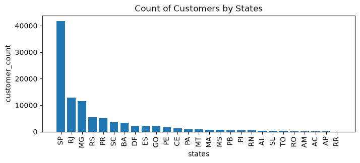
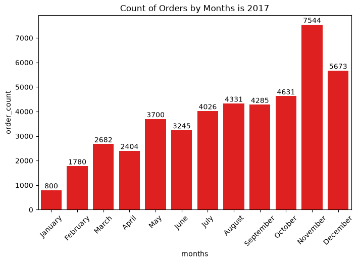
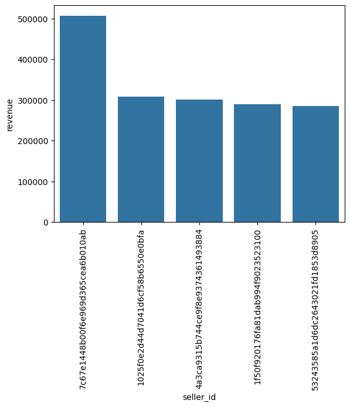

# E-commerce Sales Data Analysis: Target🎯
This project showcases an in-depth analysis of Target sales-based data. This analysis leads to the discovery of various key insights, that are supported through clarifying visualizations.

## Highlights!
- 100K+ retail transaction records
- a 15% sales variance discovered across product categories
- a correlation of -0.11 between product category, order volume, and price

## Output Charts

### Customers by Sales


### Orders by months


### Revenue per seller


## Project Structure

```bash
E-commerce-sales-data-analysis
|── data/                             # 7 raw and then cleaned datasets
│── Database Connection and Transforming copy.ipynb    # Code to clean and load data in mysql server
│── Data Analysis.ipynb               # Code to analyze cleaned datasets
│── outputs/                          # Outputs of analysis in form of various charts
│── README.md                         # Documentation
│── requirements.txt                  # Dependencies
│── .gitignore                        # Ignore sensitive/env/junk files
```

## Optional Next Steps

- Extend datasets to more significant features like methods of payment.
- Explore automation for cleaning and merging of similar datasets.
- Add predictive features using machine learning.
- Construct a dashboard synthesising findings and recommending targeted interventions.

### Authors

Hi! I am Valentina, a constant learner and the author of this project. Here's my [GitHub](https://www.github.com/bluvitriol)

